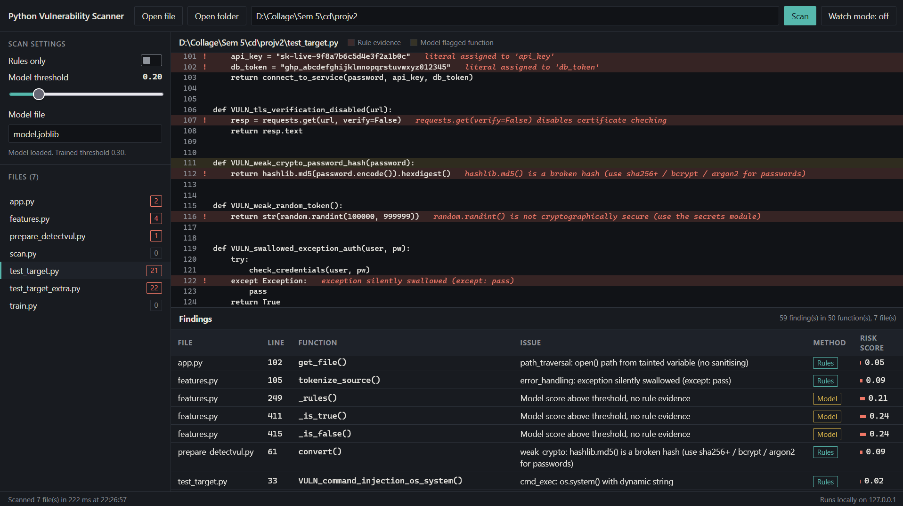

# SecureAnalyzer — Security-Focused Static Code Analyzer

A static analyzer that finds security vulnerabilities in **Python** source code **without executing it**. It combines compiler techniques (tokenizing and AST parsing), a rule-based security engine with lightweight taint tracking, and a Random Forest classifier trained on labelled vulnerable/safe functions.

Developed as the project for **BCSE307P – Compiler Design Lab**, School of Computer Science and Engineering, VIT Vellore.

## Features

- **AST-based analysis**: uses Python's `tokenize` and `ast` modules to extract structural and security-relevant features from each function.
- **Rule-based detection**: flags dangerous constructs with line numbers and descriptive messages:
  - command execution (`os.system`, `subprocess`)
  - dynamic code execution (`eval`, `exec`)
  - unsafe deserialization (`pickle`, `marshal`, `yaml.load`)
  - SQL built from dynamic strings
  - file operations and path traversal
  - weak cryptography (broken hashes, predictable randomness)
  - insecure network / TLS configuration
- **Lightweight taint analysis**: tracks values from untrusted sources (user input, environment variables, command-line arguments, web request parameters) into sensitive operations.
- **Hybrid verdict**: a function is flagged if the rules find evidence **or** the ML risk score reaches the threshold. If both agree, both are reported.
- **Real-time watch mode**: re-scans automatically whenever the file is saved.
- **Two interfaces**: command-line scanner and a local Flask web GUI.

## Project Structure

| File                                     | Purpose                                                                  |
| ---------------------------------------- | ------------------------------------------------------------------------ |
| `features.py`                            | Lexical analysis, AST feature extraction, rule engine and taint analysis |
| `train.py`                               | Trains the Random Forest model and saves it to `model.joblib`            |
| `scan.py`                                | Hybrid scanner and command-line interface                                |
| `app.py`                                 | Local web GUI (Flask) built on `scan.py`                                 |
| `index.html`                             | Front end for the web GUI                                                |
| `prepare_detectvul.py`                   | Prepares the dataset for training                                        |
| `detectvul_python.csv`                   | Labelled dataset used for training                                       |
| `model.joblib`                           | Trained model, feature vectorizer and decision threshold                 |
| `test_target.py`, `test_target_extra.py` | Vulnerable, safe and borderline programs for testing the scanner         |

## How It Works

```
Source code ─► Lexer (tokens) ─► Parser (AST) ─► Feature extraction ─┐
                                                                      ├─► Hybrid decision ─► Report
                               Rule engine + taint analysis ──────────┘
                               Random Forest risk score ──────────────┘
```

1. **Lexer**: `tokenize` breaks the code into tokens; token frequencies become features.
2. **Parser**: `ast` builds the Abstract Syntax Tree; node counts, tree depth, parameter counts and tainted-variable counts are collected.
3. **Analyzer**: the rule engine produces interpretable findings, and the Random Forest scores each function's vulnerability risk.
4. **Report**: flagged functions are listed with file, function name, line, detection source (`rules`, `model` or `rules+model`), risk score and evidence.

## Installation

Requires Python 3.8+.

```bash
git clone https://github.com/seshrutVIT/SecureAnalyzer.git
cd SecureAnalyzer
pip install scikit-learn pandas numpy joblib flask
```

## Usage

### Command line

```bash
# Scan a single file
python scan.py test_target.py

# Scan every .py file in a directory
python scan.py path/to/project/

# Re-scan every time the file is saved
python scan.py test_target.py --watch

# Rule engine only (skip the ML model)
python scan.py test_target.py --rules-only

# Override the model's decision threshold
python scan.py test_target.py --threshold 0.4

# Use a different model file
python scan.py test_target.py --model model.joblib
```

Example output format:

```
test_target_extra.py
  [!] test_target_extra.py:98  VULN_yaml_fullloader() [rules+model] model-risk=0.46
      line 99: deserialization: yaml.load() without SafeLoader
  -> 22 function(s) flagged, 23 finding(s) (139 ms)
```

### Web GUI

```bash
python app.py              # opens http://127.0.0.1:5000
python app.py --port 8080  # use a different port
```

Keep `app.py`, `scan.py`, `features.py`, `index.html` and `model.joblib` in the same folder. The server binds to `127.0.0.1` only, so it is reachable from your machine only.

### Training the model

```bash
python train.py --data detectvul_python.csv --out model.joblib
```

| Option            | Default        | Description                                                                                                  |
| ----------------- | -------------- | ------------------------------------------------------------------------------------------------------------ |
| `--data`          | required       | CSV or JSONL with `code` and `label` columns (`1` = vulnerable, `0` = safe), plus an optional `group` column |
| `--out`           | `model.joblib` | Output path for the model bundle                                                                             |
| `--trees`         | `300`          | Number of trees in the Random Forest                                                                         |
| `--target-recall` | `0.85`         | Recall the decision threshold should reach                                                                   |

When a `group` column (project, commit or CVE id) is present, a group-wise train/test split prevents near-duplicate functions from leaking between the two sets. Training prints ROC-AUC, a classification report, the confusion matrix, average latency per function and the top feature importances.

## Current Status

- **Dataset:** 1,822 labelled samples.
- **Evaluation:** 97.6% accuracy and 0.732 ROC-AUC on the initial evaluation set. Recall on the vulnerable class was 0% in that run, so the model is not yet reliable on its own. This is due to class imbalance in the dataset. The rule engine reports findings independently of the model, so rule-based detections still appear.
- **Speed:** about 40.7 ms per function for parsing plus prediction.

## Limitations and Future Work

- Python only; code with syntax errors is skipped.
- The taint analysis is lightweight and does not follow full inter-procedural data flow.
- The model needs better class balance and generalization, and the rules need more coverage.
- Planned: deeper data-flow analysis, fewer false positives and negatives, more rules, and broader accuracy and performance testing.

## Screenshots

<!-- Add screenshots here, for example:

-->

## Team

| Name                              | Registration No. |
| --------------------------------- | ---------------- |
| Seshrut Jain                      | 24BAI0117        |
| Sushruta Bera                     | 24BAI0163        |
| Joka Srinivasa Sai Krishna Sridda | 24BCE0897        |

**Guide:** Nithya K, Assistant Professor Senior Grade II, VIT Vellore

## References

1. "Real-Time Code Vulnerability Detection Using a Machine Learning-Integrated Language Server," IEEE, 2024.
2. X. Zhou et al., "Comparison of Static Application Security Testing Tools and Large Language Models," arXiv:2407.16235, 2024.
3. "Large Language Models Versus Static Code Analysis Tools: A Systematic Benchmark," IEEE Access, 2025.
4. "IRIS: A Neuro-symbolic Approach for Vulnerability Detection," arXiv:2405.17238, 2024.
